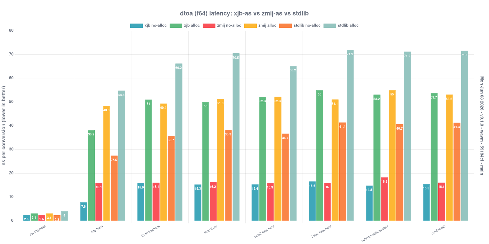
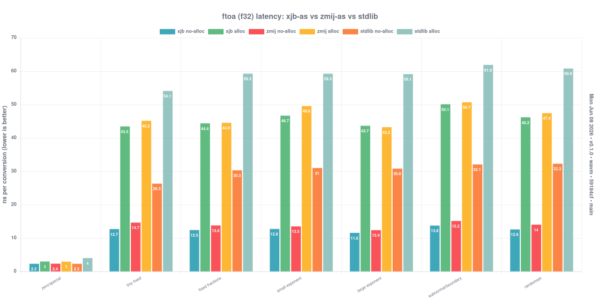

<h1 align="center"><pre>╦ ╦  ╦ ╔╗     ╔═╗ ╔═╗
 ╬   ║ ╠╩╗ ══ ╠═╣ ╚═╗
╝ ╚ ╚╝ ╚═╝    ╩ ╩ ╚═╝</pre></h1>

<p align="center">
<strong>ECMAScript-formatted</strong>
<code>f64</code>/<code>f32</code> → string for
<a href="https://www.assemblyscript.org/">AssemblyScript</a>, built on the
<strong><a href="https://github.com/xjb714/xjb">xjb</a></strong> / <strong><a href="https://github.com/vitaut/zmij" >Żmij</a></strong> family of shortest-decimal cores.
</p>

<details>
<summary>Table of Contents</summary>

- [Installation](#installation)
- [Usage](#usage)
- [API](#api)
- [Performance](#performance)
- [Verification](#verification)
- [Benchmarks](#benchmarks)
- [Architecture](#architecture)
- [Credits](#credits)
- [License](#license)
- [Contact](#contact)

</details>

## Installation

```bash
npm install xjb-as
```

`xjb-as` is plain exported functions - no compiler transform required. The digit
kernel uses [SIMD](https://en.wikipedia.org/wiki/Single_instruction,_multiple_data) when available
and falls back to scalar [SWAR](https://en.wikipedia.org/wiki/SWAR) otherwise.

To enable SIMD, add to your `asc` command:

```bash
--enable simd
```

Or in your `asconfig.json`:

```json
{
  "options": {
    "enable": ["simd"]
  }
}
```

## Usage

```typescript
import { dtoa, dtoa_buffered, ftoa, ftoa_buffered } from "xjb-as";

dtoa(3.14159);     // "3.14159"
dtoa(1e21);        // "1e+21"
dtoa(-0.0);        // "0"
ftoa(0.1);         // "0.1"
```

Writing a serializer with its own buffer? Skip the `String` allocation and write
UTF-16 straight into your buffer:

```typescript
// UTF-16 written directly into your buffer (>= 56 bytes); no allocation.
const codeUnits = dtoa_buffered(buffer, value);
```

`dtoa(x)` matches `Number.prototype.toString()` for f64 values, including
`Infinity`, `-Infinity`, `NaN`, `-0 → "0"`, `1e21 → "1e+21"`, `1e-7 → "1e-7"`,
and ECMAScript's fixed/exponential thresholds and signed exponent format.
For finite f64 values this also matches JSON number output. JSON serializers
must handle nonfinite values separately, typically by writing `null`.

`ftoa` chooses the shortest decimal that round-trips to **binary32**, with the
same ECMAScript notation rules. It does not format the widened binary64 value:
`ftoa(<f32>0.1)` is `"0.1"`, while `Math.fround(0.1).toString()` is
`"0.10000000149011612"`.

## API

```typescript
dtoa(value: f64): string                 // shortest round-trip, ECMAScript-formatted
dtoa_buffered(buffer, value: f64): u32   // write UTF-16 into buffer, return code-unit count
ftoa(value: f32): string                 // shortest round-trip, ECMAScript-formatted
ftoa_buffered(buffer, value: f32): u32   // write UTF-16 into buffer, return code-unit count
```

**Buffer contract.** `dtoa_buffered` / `ftoa_buffered` write the shortest decimal
as UTF-16 *directly* into `buffer` (no intermediate ASCII pass or widening);
`buffer` needs ≥ 56 bytes (28 UTF-16 code units). The returned code-unit count is exact. Always provide the complete 56-byte
writable region regardless of that count; stores may extend beyond the logical
output, and contents beyond the returned length are unspecified.

## Performance

<p align="center">

</p>
<p align="center">

</p>

Charts are published per release to the `docs` branch via `npm run charts:publish`
(`scripts/publish-charts.sh`) and pinned here by version. Benchmark results retain
source revision and dirty state, source fingerprint, measurement timestamp,
compiler/runtime versions, build and optimizer flags, machine identity, and the
Wasm artifact hash. Charts use this saved metadata. Historical logs without it
must be regenerated. Publishing requires complete results from compatible runs
on a clean checkout matching the measured revision, and publishes only images
rendered during that invocation. `--no-run` reuses results subject to these checks.

## Verification

Verification compares f64 output with V8 `Number::toString` and f32 output
with exact BigInt rounding intervals and ties-to-even. The debug/release ×
scalar/SIMD matrix checks both allocating and buffered APIs, signed exponent
boundaries, integer shortcuts, subnormals, buffer canaries, digit packing, and
all 618 cached powers. The verifier and fuzzer also exercise seeded random inputs.

```bash
# generate the as-test spec from the V8 oracle, then run the suite
npm run gen-spec
npm test

# check debug/release scalar/SIMD, buffer bounds, cached powers, and V8 outputs
# then verify the optimized builds with fixed edges + 2M random inputs per width
npm run verify
npm run verify:matrix
node scripts/dtoa/verify.mjs 3000
node scripts/dtoa/verify.mjs 0 # explicitly run edges only

# open-ended differential fuzz vs V8 (seeded, repro-friendly; --runs/--time/--seed)
npm run fuzz
```

## Benchmarks

Benchmarks compare xjb-as with the AssemblyScript standard library.
`ASC_BIN` can select a specific compiler's `bin/asc.js` without replacing the
installed compiler; its version and hash are captured with the measurements.

```bash
npm run bench -- --v8 --wavm
npm run charts:build -- --v8 --wavm
npm run charts:serve
```

## Binary size

Both widths now share a compact power-of-ten cache in every build, ported from
[AssemblyScript PR #3025](https://github.com/AssemblyScript/assemblyscript/pull/3025)
at `f97f67d`. Common exponents use direct loads; the remaining powers are
reconstructed from 23 anchors and exact correction bits. The normalized-power
cache totals 872 bytes, replacing the old full/compressed f64 tables and separate f32 cache.
No shrink-level switch or runtime initialization is needed.

Kernel charts compare standalone general decimal/digit kernels with complete API
calls. Integer and special-value shortcuts mean these are independent measurements,
not additive stages of every public call.

The performance charts above describe v0.1.0, before this port; they have not
been regenerated for the current implementation.

## Architecture

Three modules under `assembly/`:

- **`dtoa.ts`** (f64) — ports the upstream `xjb64` v2 shortest-decimal core.
- **`ftoa.ts`** (f32) — xjb's single-hi-multiply f32 core with a narrow
  64×24 product, integer shortcuts, and bounded subnormal scaling.
- **`xjb.ts`** — the shared engine: 128-bit math, compact power cache,
  SIMD/SWAR digit kernels, integer and exponent writers, and UTF-16 layout.

The formatter lays out digits per the [ECMA-262 `Number::toString` decision tree](https://tc39.es/ecma262/multipage/ecmascript-data-types-and-values.html#sec-numeric-types-number-tostring) and stores UTF-16 directly.

## Credits

The shortest-decimal **digits** are identical to Ryū/Dragonbox (shortest,
round-to-nearest-even) - exactly what ECMA-262 mandates; only the surface
formatting differs.

## License

[MIT + Apache-2.0 notices](./LICENSE)

## Contact

Please send all issues to [GitHub Issues](https://github.com/JairusSW/xjb-as/issues) and to converse, please send me an email at [me@jairus.dev](mailto:me@jairus.dev)

- **Email:** Send me inquiries, questions, or requests at [me@jairus.dev](mailto:me@jairus.dev)
- **GitHub:** Visit the official GitHub repository [Here](https://github.com/JairusSW/xjb-as)
- **Website:** Visit my official website at [jairus.dev](https://jairus.dev/)
- **Discord:** Contact me at [My Discord](https://discord.com/users/600700584038760448) or on the [AssemblyScript Discord Server](https://discord.gg/assemblyscript/)
